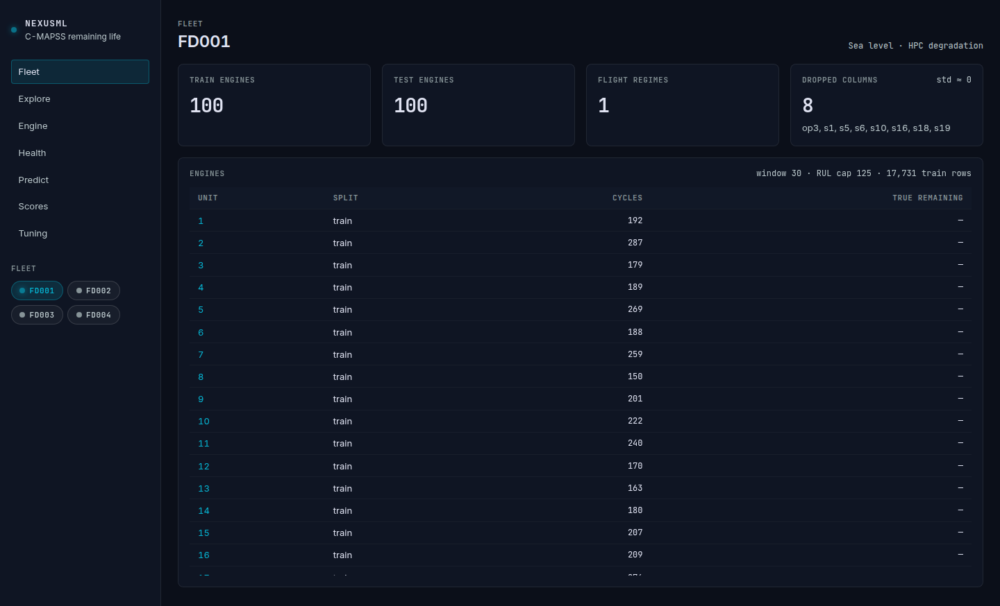
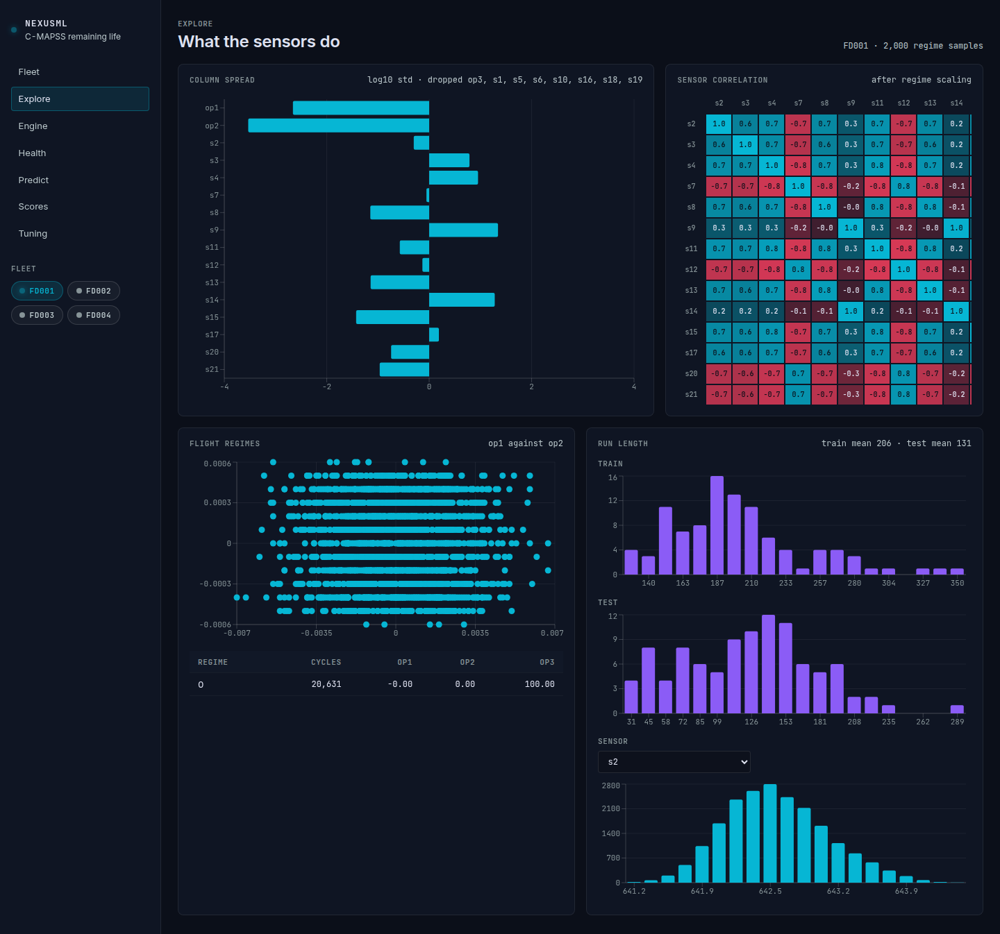
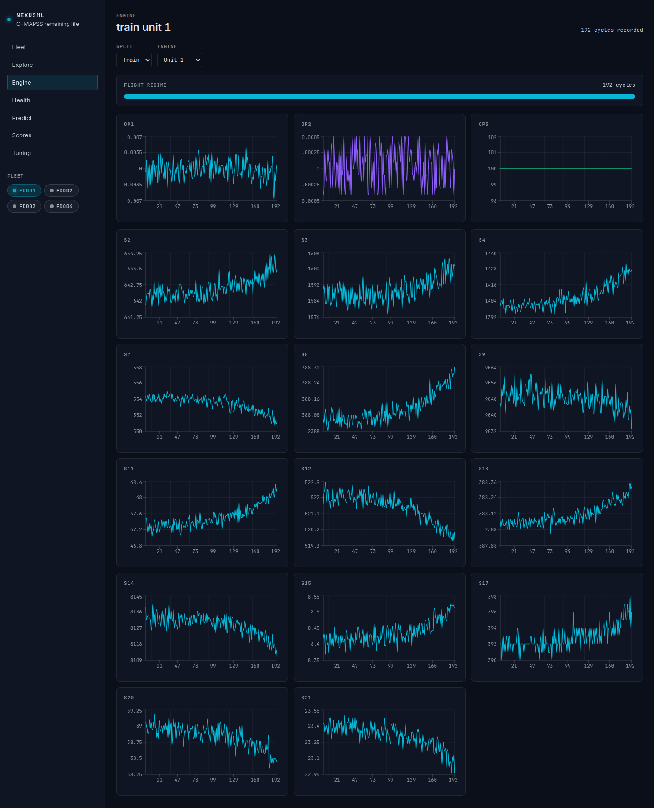
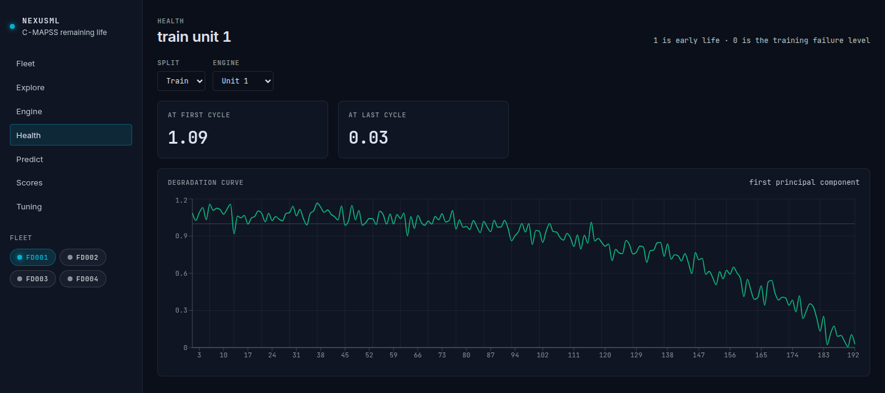
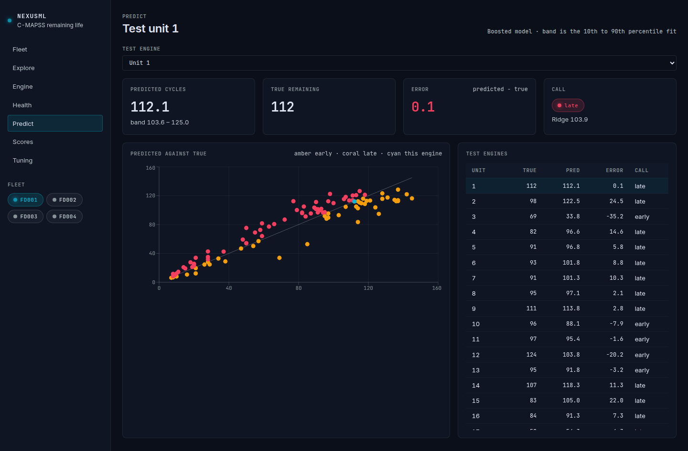
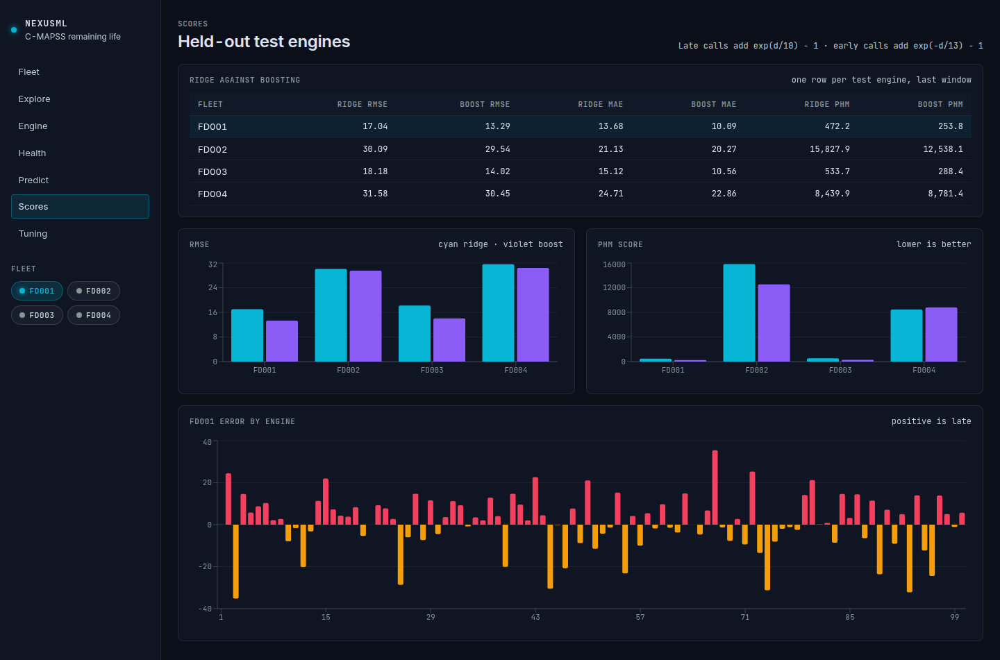
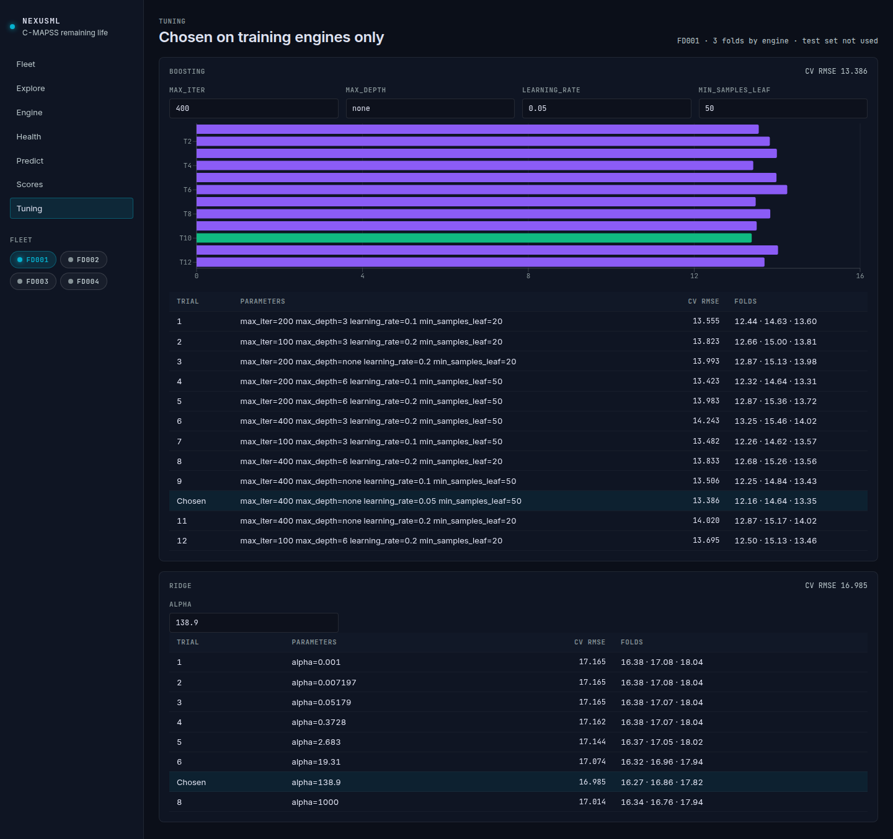

# NexusML C-MAPSS workbench

Remaining-life models for the four NASA C-MAPSS turbofan fleets, and a Next.js viewer for the cleaning report, exploration charts, health curves, predictions, scores, and tuning trials.

## Pipeline

```bash
python3 -m venv .venv
.venv/bin/pip install -r requirements.txt
.venv/bin/python -m ml.run
.venv/bin/python -m ml.serve
```

`ml.run` writes `artifacts/FD00x/`. The API on port 8000 only reads those files. The official test files are not used to choose parameters.

## UI

```bash
cd web
npm install
npm run dev
```

Open [http://127.0.0.1:3000](http://127.0.0.1:3000). The fleet pills switch FD001–FD004 on every page.

## Screenshots

FD001, unit 1.



Fleet, `/`. Train and test counts, dropped columns, and the engine list.



Explore, `/explore`. Sensor spread, correlation, flight regimes, and run length.



Engine, `/engine`. Operating settings and kept sensors for train unit 1.



Health, `/health`. Degradation curve for train unit 1.



Predict, `/predict`. Held-out prediction for test unit 1.



Scores, `/scores`. Ridge and boosting on all four fleets, with FD001 errors.



Tuning, `/tuning`. Training-only search for FD001.
